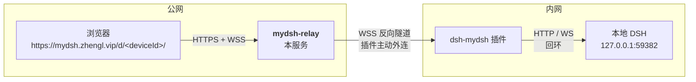

# mydsh-relay

`dsh-mydsh` 插件配套的**中转服务端**。它让一台位于内网（没有公网 IP、没有端口映射）的 DeepSeek Harness
实例，能够被公网浏览器通过 HTTPS 正常访问。

- 纯 Node.js，**零外部依赖**，不需要 `npm install`
- 自己实现 RFC 6455（握手 / 帧编解码 / 分片 / ping-pong / close 握手 / 三种长度编码）
- 同时转发 **WebSocket** 与 **普通 HTTP**（DSH 的 SPA 资源、REST 接口都能过）
- 自带用户体系、设备凭据、登录限流、CSRF 防护与错误页

> ⚠️ **安全前提**：本服务的作用是「把你内网的 DSH 暴露到公网」。请先读完
> [安全说明](#安全说明) 再部署。**必须**通过 HTTPS 对外提供服务。

---

## 一、它解决什么问题

内网的 DSH 没有公网地址，公网浏览器连不上。常见做法是端口映射或内网穿透，
但那需要路由器权限，且会把整台机器的端口直接暴露出去。

本服务改成**反向隧道**：内网侧的插件主动向外连接中转服务，中转服务再把自己的连接借给访客。
内网侧不需要任何入站端口。



**关键点**：箭头方向。内网侧只发起**出站**连接，所以内网不需要开端口、不需要公网 IP。

### 一条访客请求的完整路径

```text
浏览器 GET https://mydsh.zhengl.vip/d/d_abc123/assets/index.js
  │
  ├─(1) nginx 终止 TLS，proxy_pass 到 127.0.0.1:8787
  │
  ├─(2) relay 解析路径 → deviceId=d_abc123, 目标路径=/assets/index.js
  │
  ├─(3) 找到该 deviceId 的隧道连接，分配一个 streamId
  │     发控制帧 {"t":"http.req","id":7,"method":"GET","path":"/assets/index.js",...}
  │
  ├─(4) 插件收到后请求 127.0.0.1:59382/assets/index.js
  │
  ├─(5) 插件发回 {"t":"http.res","id":7,"status":200,"headers":{...}}
  │     再发二进制帧 [0x03|7|字节流...]，最后 {"t":"http.res.end","id":7}
  │
  └─(6) relay 用 streamId 找到挂起的 res 对象，把响应流式写回浏览器
```

WebSocket 走同一套机制，只是用 `ws.open` / 二进制数据帧 / `ws.close` 三个消息。

---

## 二、文件结构

```text
mydsh-relay/
├── package.json                  # 零依赖；type=module；node >= 20.11
├── relay.config.example.json     # 配置模板（复制为 relay.config.json）
├── README.md                     # 本文档
├── deploy.md                     # 宝塔面板部署完整步骤
└── src/
    ├── server.js                 # 入口：配置装载、HTTP/HTTPS、路由、upgrade 分流、优雅退出
    ├── websocket.js              # RFC 6455：握手、帧编解码、连接类、心跳
    ├── auth.js                   # token 签发校验、登录/注册、限流器、设备凭据校验
    ├── users.js                  # 用户与设备持久化（原子写）、scrypt 哈希
    ├── tunnel.js                 # 隧道配对、channelId 管理、HTTP 请求-响应配对、流控
    ├── static.js                 # 内置页面（首页/登录/注册/设备/错误页）
    └── util.js                   # 日志、JSON 响应、校验、IP 匹配、header 消毒、原子写
```

运行期会在数据目录下生成：

```text
data/
├── users.json      # 用户 + 设备（chmod 600）
└── signing.key     # token 签名密钥（chmod 600，首次启动自动生成）
```

---

## 三、快速开始

```bash
cd mydsh-relay
cp relay.config.example.json relay.config.json
# 编辑 relay.config.json：至少改 domain / publicUrl
node src/server.js
# 打开 http://127.0.0.1:8787
```

首次使用流程：

1. 打开首页 → **注册**账号
2. 登录 → 进入**设备管理** → **注册设备**
3. 页面会**一次性**显示 `deviceId` 与 `deviceSecret` —— 立刻复制
4. 把它们填进 DSH 里的 `dsh-mydsh` 插件配置，中转地址填 `https://mydsh.zhengl.vip`
5. 设备页显示「在线」后，访问 `https://mydsh.zhengl.vip/d/<deviceId>/`

---

## 四、配置说明

`relay.config.json` 与 `src/server.js` 里的 `DEFAULTS` 合并，**环境变量优先级最高**。
配置文件可以不存在（纯环境变量部署），但会打一条 warning。

### 监听与 TLS

| 字段 | 默认 | 说明 |
|---|---|---|
| `listen.host` | `0.0.0.0` | 只在本机反代时应设为 `127.0.0.1` |
| `listen.port` | `8787` | Node 监听端口 |
| `tls.enabled` | `false` | 让 Node 自己终结 TLS。**用 nginx 做 HTTPS 时保持 false** |
| `tls.certPath` / `tls.keyPath` | `""` | 证书与私钥。宝塔的 Let's Encrypt 证书路径见 deploy.md |
| `domain` | `localhost` | 对外域名，用于 Host/Origin 校验与 cookie |
| `publicUrl` | 自动推导 | 对外完整地址，建议显式写 `https://mydsh.zhengl.vip` |

> `tls.enabled=true` 与 nginx 反代**二选一**，不要同时开，否则会变成 TLS 套 TLS。

### 数据与密钥

| 字段 | 默认 | 说明 |
|---|---|---|
| `dataDir` | `./data` | 数据目录 |
| `usersFile` | `<dataDir>/users.json` | 用户库路径 |
| `signingKeyFile` | `<dataDir>/signing.key` | 签名密钥文件，不存在则自动生成 |
| `tokenSecret` | `""` | 直接给密钥（≥32 字符）。**不推荐写进配置文件，用环境变量** |

### 认证

| 字段 | 默认 | 说明 |
|---|---|---|
| `auth.allowRegistration` | `true` | 关掉后只能手工改 users.json 加人（或先开着注册再关） |
| `auth.maxUsers` | `50` | 注册人数上限 |
| `auth.inviteCode` | `""` | 非空则注册必须带邀请码 |
| `auth.tokenTtlSec` | `43200` | 会话有效期（12 小时），范围 300 – 2592000 |
| `auth.cookieName` | `mydsh_token` | 会话 cookie 名 |
| `auth.cookieSecure` | `true` | 仅 HTTPS 下发送 cookie |
| `auth.requireEmailVerification` | `false` | **扩展点**，见下文 |

### 限流与隧道

| 字段 | 默认 | 说明 |
|---|---|---|
| `limits.maxDevicesPerUser` | `5` | 单用户设备数上限 |
| `limits.loginMaxFailures` | `5` | 触发指数退避锁定的失败次数 |
| `limits.registerPerHour` | `10` | 单 IP 每小时注册尝试 |
| `limits.upgradeAttemptsPerMinute` | `30` | 单 IP 每分钟 WebSocket 升级次数 |
| `limits.apiRequestsPerMinute` | `120` | 单 IP 每分钟 API 调用 |
| `limits.maxBodyBytes` | `26214400` | 转发请求体上限（25 MiB） |
| `limits.maxJsonBodyBytes` | `65536` | 本服务自身 API 的 JSON 上限 |
| `tunnel.heartbeatMs` | `30000` | ping 间隔；两轮无 pong 即清理连接 |
| `tunnel.httpTimeoutMs` | `60000` | 单次 HTTP 转发超时（超时回 504） |
| `tunnel.maxChannelsPerDevice` | `32` | 单设备并发 WS 通道上限 |
| `tunnel.maxMessageBytes` | `16777216` | 单条隧道消息上限（16 MiB） |

### 安全

| 字段 | 默认 | 说明 |
|---|---|---|
| `security.trustProxy` | `true` | **反代场景必须 true**，否则看到的客户端 IP 全是 127.0.0.1 |
| `security.visitorRequireAuth` | `false` | true 时访客必须登录且是设备所有者 |
| `security.globalIpAllowlist` | `[]` | 全局 IP/CIDR 白名单，空 = 不限制 |
| `security.allowedOrigins` | `[]` | 额外允许的 WebSocket Origin |
| `security.hsts` | `false` | 下发 HSTS 头（nginx 上配更合适） |

### 环境变量

| 变量 | 对应字段 |
|---|---|
| `MYDSH_RELAY_PORT` | `listen.port` |
| `MYDSH_RELAY_HOST` | `listen.host` |
| `MYDSH_RELAY_DOMAIN` | `domain` |
| `MYDSH_RELAY_PUBLIC_URL` | `publicUrl` |
| `MYDSH_RELAY_DATA_DIR` | `dataDir` |
| `MYDSH_RELAY_TOKEN_SECRET` | `tokenSecret` |
| `MYDSH_RELAY_INVITE_CODE` | `auth.inviteCode` |
| `MYDSH_RELAY_ALLOW_REGISTRATION` | `auth.allowRegistration`（`1`/`true`/`yes`） |
| `MYDSH_RELAY_TLS_CERT` | `tls.certPath` |
| `MYDSH_RELAY_TLS_KEY` | `tls.keyPath` |
| `MYDSH_RELAY_TRUST_PROXY` | `security.trustProxy` |
| `MYDSH_RELAY_LOG_LEVEL` | `log.level` |

生成一个签名密钥：

```bash
node -e "console.log(require('crypto').randomBytes(32).toString('base64url'))"
```

---

## 五、HTTP API

除 `/api/health` 外都需要登录。凭据可用 `Authorization: Bearer <token>`
或 cookie（登录时两者都会下发）。

| 方法 | 路径 | 说明 |
|---|---|---|
| `GET` | `/api/health` | 健康检查（无需登录），返回在线设备/通道数 |
| `POST` | `/api/register` | `{username, password, inviteCode?}` → 201 |
| `POST` | `/api/login` | `{username, password}` → `{token, user, expiresAt}` |
| `POST` | `/api/logout` | 清除 cookie（无状态 token 无法真正吊销，改密码才行） |
| `GET` | `/api/me` | 当前用户 |
| `GET` | `/api/devices` | 设备列表（含 `online` / `channels`） |
| `POST` | `/api/devices` | `{name}` → **一次性返回 `deviceSecret`** |
| `PATCH` | `/api/devices/:id` | `{name?, tunnelEnabled?}` |
| `DELETE` | `/api/devices/:id` | 删除设备并断开隧道 |
| `POST` | `/api/devices/:id/rotate` | 轮换密钥，**旧密钥立即失效**，并踢掉现有隧道 |

### 错误格式

```json
{ "ok": false, "code": "EBADCRED", "message": "用户名或密码错误" }
```

| 状态 | code | 含义 |
|---|---|---|
| 400 | `EINVAL` | 输入不合法 |
| 401 | `EUNAUTH` / `EBADCRED` | 未登录 / 用户名或密码错误 |
| 403 | `ECSRF` / `EIPDENY` / `EREG_DISABLED` / `EINVITE` | 跨站请求 / IP 白名单 / 关闭注册 / 邀请码错 |
| 404 | `ENOTFOUND` | 设备或接口不存在 |
| 409 | `EUSERNAME_TAKEN` / `EDEVICE_LIMIT` | 用户名占用 / 设备数上限 |
| 413 | — | 请求体过大 |
| 429 | `ERATE` | 触发限流，响应带 `Retry-After` |
| 502 | — | 内网设备返回错误 / 隧道中断 |
| 503 | `EOFFLINE` / `EBUSY` | 设备离线 / 通道已满 |
| 504 | — | 内网设备响应超时 |

因为登录失败会**统一延迟到 80ms 以上**再返回，剩余的响应时间差异会被限流的不确定性盖住。

---

## 六、隧道协议（relay ⇄ 插件端）

这一节是给插件实现者看的。**浏览器只需要访问 `/d/<deviceId>/`，不需要知道协议。**

### 6.1 插件端接入

```http
GET /tunnel?deviceId=d_xxx&deviceSecret=yyy   （或下面两种头）
X-Device-Id: d_xxx
X-Device-Secret: yyy
```

三者任选其一，优先级：query `deviceId` > `X-Device-Id` > `Authorization: Bearer`。

> 强烈建议用 **header** 而不是 query：nginx 默认会把 query string 写进 access log，
> 等于把设备密钥落到日志里。本服务检测到 query 方式会打 warning。

鉴权失败时**不会**返回 101，而是直接回 `HTTP/1.1 403`，插件端能拿到明确的失败原因。

### 6.2 帧格式

一条 WebSocket 复用所有通道。**控制消息用 JSON 文本帧，数据用二进制帧**：

```text
二进制帧（5 字节头 + payload）
┌────────┬──────────────────────┬──────────────┐
│ 1 byte │  4 byte streamId BE  │   payload    │
│  type  │      (32 位)         │              │
└────────┴──────────────────────┴──────────────┘
  type 低 7 位 = kind
  type 最高位 0x80 = 该消息原文是 WebSocket 二进制帧（仅 kind=0x01 有意义）

  kind 0x01  WS 数据
  kind 0x02  HTTP 请求体分片
  kind 0x03  HTTP 响应体分片
```

### 6.3 控制消息

**relay → 插件**

| `t` | 字段 | 含义 |
|---|---|---|
| `hello` | `v, deviceId, serverTime, limits` | 连接后的第一帧，协议版本确认为 1 |
| `ws.open` | `id, ip, ua, path, host` | 有新访客，请在本地 DSH 上开一条 WS |
| `ws.close` | `id, code, reason` | 访客断开，请关闭本地 WS |
| `ws.flow` | `id, pause` | 请暂停/恢复从本地 DSH 读取 |
| `http.req` | `id, method, path, query, headers, ip, timeoutMs` | 新 HTTP 请求 |
| `http.req.end` | `id` | 请求体发送完毕 |
| `http.abort` | `id, reason` | 访客已断开，请放弃该请求 |
| `http.flow` | `id, pause` | 请暂停/恢复响应体推送 |

**插件 → relay**

| `t` | 字段 | 含义 |
|---|---|---|
| `ws.close` | `id, code, reason` | 本地 WS 关闭，转告访客 |
| `ws.flow` | `id, pause` | 本地读不动了，请让访客暂停发送 |
| `http.res` | `id, status, headers` | 响应头（`set-cookie` 用数组支持多值） |
| `http.res.end` | `id` | 响应结束 |
| `http.res.error` | `id, status, message` | 请求失败，映射成 5xx |
| `http.flow` | `id, pause` | 我这边写不动了，请暂停推送 |

### 6.4 插件端实现要点

1. **必须支持并发**：同一个 `deviceId` 可能同时有几十个 `streamId`。
2. **文本/二进制要按 `0x80` 位还原**：不能按通道记一个「这通道是二进制」的标志。
   WebSocket 允许同一条连接混发文本帧和二进制帧，浏览器端真的会区分
   （`string` vs `Blob`）。用全局标志会让某个通道后续所有文本都变成 Blob。
3. **`http.req.end` 只带 `id`**：路径/方法都在 `http.req` 里，实现时记得按 `id` 关联。
4. **响应头必须过滤 hop-by-hop**（`connection`、`transfer-encoding`、`content-length` 等）。
   本服务侧也会再过滤一次并剔除 CR/LF，但双保险更稳。
5. **`set-cookie` 用数组**，否则多枚 cookie 会被拼成一条坏值。
6. **心跳**：relay 每 `heartbeatMs` 发一次 ping，两轮无 pong 就断开。插件端浏览器/Node 的
   WebSocket 实现一般会自动回 pong，不需要手写。
7. **重连**：用**指数退避**（如 1s、2s、4s…上限 30s），不要写死 1 秒狂重连。
   重连后旧连接会被服务端主动替换，不需要先发关闭。

---

## 七、安全说明

### 7.1 这个服务在做什么危险的事

它把一台内网机器上的 Web GUI 变成公网可访问。DSH GUI 通常**没有**第二层认证，
一旦有人拿到 `https://你的域名/d/<deviceId>/`，就能操作那台机器上的 DSH。

因此本服务把设备 ID 当作**秘密链接**（capability URL）：`deviceId` 是 12 字节随机数
（96 bit 熵），不可枚举；但这**不等于**认证。请自己判断风险。

### 7.2 已实现的缓解措施

| 措施 | 实现位置 | 说明 |
|---|---|---|
| 强制 HTTPS | deploy.md | 明文传输等于把 token 和设备凭据广播出去 |
| 密码 scrypt 加盐哈希 | `users.js` | N=2^15, r=8, p=1；参数随哈希一起存，便于将来升级 |
| 设备密钥 scrypt 哈希 | `users.js` | 库里**不存明文**，`users.json` 泄露也无法冒充设备 |
| 登录限流（指数退避） | `auth.js` | 按 IP、IP+用户名、用户名三个维度；用户名不存在也照算哈希，防枚举 |
| 注册限流 | `auth.js` | 按 IP，配合邀请码可完全关闭公开注册 |
| 定长比较 | `util.js` | token 签名、邀请码都用 `timingSafeEqual` |
| token HMAC-SHA256 | `auth.js` | 自包含、带 `exp`/`nbf`/`jti`；改密码 `tokenVersion+1` 让全部旧 token 失效 |
| CSRF 防护 | `server.js` | 写操作校验 `Origin`；cookie `SameSite=Lax`、`HttpOnly` |
| WebSocket Origin 校验 | `server.js` | 挡「你打开的恶意网页偷偷连内网设备」 |
| 防路径穿越 | `server.js` | 拒绝 `..`/`.`/空字节/非法百分号编码 |
| 防 header 注入 | `util.js` | 插件回传的 header 一律剔除 CR/LF 与控制字符 |
| 请求体上限 | `server.js` | 声明长度 + 流式读取双重校验，防 chunked 绕过 |
| CSP / nosniff / frame-ancestors | `server.js` | 页面禁止外部资源；禁止被 iframe 嵌套 |
| 会话 cookie 不外泄 | `tunnel.js` | 转发给内网时剥掉 relays 自己的 `mydsh_token` cookie |
| 数据文件权限 | `users.js`/`server.js` | 目录 700、文件 600 |
| 原子写 | `util.js` | 临时文件 + fsync + rename，进程被杀不会留下半截 JSON |

### 7.3 你必须自己做的事

- [ ] **一定用 HTTPS**。没有证书就不要上线。
- [ ] 账号密码**至少 16 位**，别复用别的站点密码。
- [ ] 上线后**尽早关闭公开注册**（`auth.allowRegistration: false`），或设置 `inviteCode`。
- [ ] 定期检查 `users.json` 里的设备列表，删掉不认识的设备。
- [ ] 怀疑 `deviceSecret` 泄露 → 立刻在设备页点**换密钥**（旧密钥立即失效、现有隧道被踢）。
- [ ] 怀疑账号泄露 → 改密码（所有旧 token 立刻失效）。
- [ ] 可选：配 `security.globalIpAllowlist` 只允许自己的常用 IP 访问 `/tunnel`。

### 7.4 deviceSecret 泄露的影响面

| 泄露项 | 攻击者能做什么 | 立刻处置 |
|---|---|---|
| `deviceSecret` | 冒充该设备上线，把访客流量接到自己的机器上 | 设备页「换密钥」 |
| `deviceId` | 只是知道访问地址，**无法冒充设备** | 无（除非你关闭了 `visitorRequireAuth` 且不想被访问） |
| 用户 token | 管理设备、轮换密钥 | 改密码或等过期 |
| `signing.key` | **可伪造任意用户的 token** | 删除该文件并重启，所有用户重新登录 |

### 7.5 「每次登录需邮箱验证」扩展点

`auth.requireEmailVerification` 目前**只开了一个钩子，没有实现发信**。开启后如果没注册验证器，
登录会**直接失败**并提示未配置 —— 这是刻意的：避免给运营者「我已经开了邮箱验证」的虚假安全感。

接入方式（在 `server.js` 里 `main()` 中 `new TunnelHub` 之后）：

```js
auth.registerLoginVerifier(async ({ user, ip, userAgent }) => {
  // 抛错 = 拒绝登录；返回 = 通过
  const code = await mySendMail(user.username + '@example.com');
  const ok = await myWaitForUserInput(code);
  if (!ok) throw new Error('邮箱验证码不正确');
});
```

注意：钩子是**异步**的，阻塞期间会占住一个 HTTP 连接。真实实现应该改成
「下发 challenge → 前端轮询/回调」，而不是在登录请求里干等。

### 7.6 做不到 / 已知限制

- **无状态 token 无法单条吊销**。只能靠改密码（全量失效）或等过期。
  如果需要「踢掉某一个会话」，得引入服务端会话表。
- **无审计日志归档**。日志打到 stdout，靠 systemd/journald 或 pm2 收集。
  要做合规审计得外接日志系统。
- **单进程**。`users.json` 是单文件 + 内存态，**不能多实例共享**。
  要横向扩展必须换掉 `users.js` 的存储层。
- **没有内置 2FA / 邮件**。见 7.5，只有扩展点。
- **设备端不受控**。中继只负责转发字节，内网 DSH 的认证与权限完全由 DSH 自己决定。

---

## 八、运维

### 日志

一行一条，便于 `grep`：

```text
2026-11-15T14:15:54.669Z INFO  [server] mydsh-relay 已启动 {"scheme":"http","listen":"127.0.0.1:8787",...}
```

敏感字段（`secret`/`token`/`password`/`cookie`…）在落日志前会被替换成 `[redacted]`。
`log.level` 可选 `debug` / `info` / `warn` / `error` / `silent`。

### 健康检查

```bash
curl -s http://127.0.0.1:8787/api/health
```

```json
{"ok":true,"service":"mydsh-relay","uptimeSec":123,
 "stats":{"devices":1,"channels":2,"httpPending":0,"wsOpened":15,"deviceRejects":3}}
```

### 优雅退出

`SIGTERM` / `SIGINT` 时会：停止接受新连接 → 通知所有设备关闭 → 落盘 → 退出。
15 秒内没退干净会强制 `exit(1)`。

### 常见故障

| 现象 | 原因 | 处置 |
|---|---|---|
| 浏览器控制台 `WebSocket connection failed` | nginx 没配 `Upgrade`/`Connection` 头 | 见 deploy.md 的反代配置 |
| 设备一直显示「离线」 | 插件端连不上 / 密钥错 | `journalctl -u mydsh-relay -f` 看有没有 `设备鉴权失败` |
| 所有访客 IP 都是 `127.0.0.1` | `security.trustProxy` 是 false | 设为 true |
| 502 且日志有 `内网设备响应超时` | 内网 DSH 挂了 / 太慢 | 调大 `tunnel.httpTimeoutMs` |
| 首屏白屏、接口正常 | 静态资源 404 | 检查插件端是否正确处理了 `path` |
| 登录一直 429 | 触发退避锁定 | 等锁定时间过去，或重启服务（内存态限流） |

---

## 九、验证情况

本项目已用真实进程做过两套验证（脚本在开发目录的 `APP/tmp/relay-verify/`，
不属于交付物）：

- **端到端**：54 项，全部通过。覆盖注册/登录/鉴权、设备注册与轮换、隧道建立、
  多访客并发、文本与二进制往返、70KB/200KB 消息、HTTP GET/POST 转发、
  10 并发请求 requestId 配对、512KB 大响应、多 `set-cookie`、204、502 映射、
  路径穿越、CSRF、Origin 校验、登录限流、cookie 剥离。
- **WebSocket 协议层**：23 项，全部通过。覆盖 Accept 计算、分片序列、
  分片中的 ping、未掩码帧、RSV 位、非法 UTF-8、64 位长度最高位、
  控制帧分片、控制帧超长、孤立续帧、close 握手、非法 close 码、
  125/126/65535/65536 长度边界、逐字节到达重组、版本协商、缺失 upgrade token。

未在真实公网域名 + 真实宝塔 + 真实 DSH 实例上做端到端验证（需要实际服务器和证书）。
部署后请先自己访问一遍 `https://你的域名/api/health` 和 `/d/<deviceId>/` 确认。

---

## 十、协议版本

隧道协议版本 `1`，即 `hello.v = 1`。任何不兼容变更都会递增该数字，
插件端应在收到 `hello` 后立即校验，不匹配就断开并提示升级。
